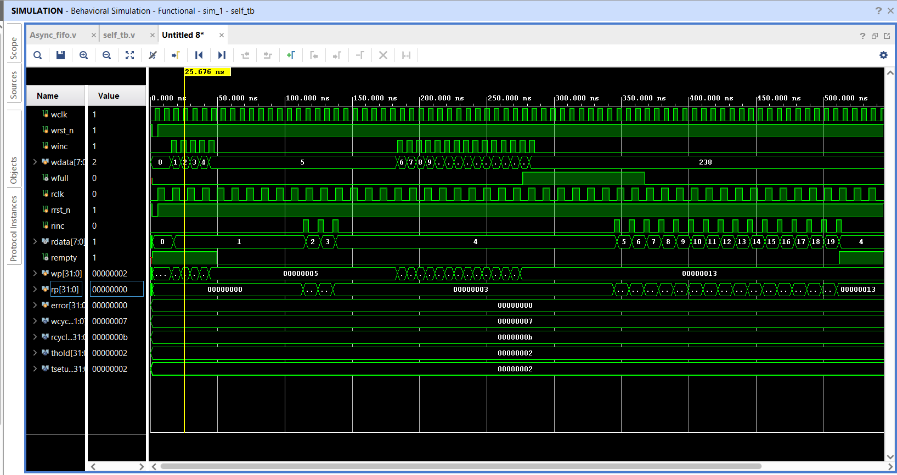
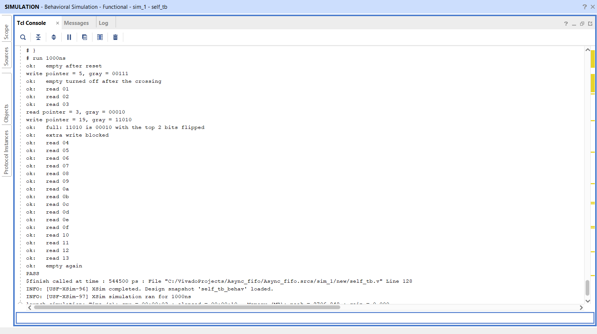

# Asynchronous FIFO (16 × 8-bit) using Verilog HDL

## 🧠 Project Overview

I designed a 16 × 8-bit asynchronous FIFO using Verilog HDL. It transfers data between two independent clock domains: a 7 ns write clock and an 11 ns read clock.

Since the write and read clocks are different, I used Gray-code pointers and two-flop synchronizers to safely transfer pointer information between the two clock domains.

Through this project, I got practical experience with asynchronous FIFO design, clock domain crossing (CDC), pointer management, and full and empty detection.

---

## 🚀 Key Features

- 16 memory locations, each storing 8 bits.
- Separate write and read clocks with independent active-low resets.
- 5-bit write and read pointers (4 address bits plus 1 lap bit).
- Gray-code conversion for pointer synchronization.
- Two-flop synchronizers in both clock domains.
- Registered full and empty flags.
- Self-checking testbench to verify FIFO operations.

---

## 📖 Background

### Why an asynchronous FIFO?

An asynchronous FIFO is useful when two parts of a design operate using different clocks. It allows data to be written using one clock and read using another.

### Why Gray code?

I used Gray code for pointer synchronization because only one bit changes between consecutive values. This helps reduce the possibility of incorrect pointer information when crossing between clock domains.

### Why two flip-flops?

When signals cross between independent clock domains, metastability can occur. I used two flip-flops in each synchronizer to reduce the possibility of metastability propagating into the FIFO control logic.

### Why 5-bit pointers for 16 locations?

A 16-location FIFO needs 4 bits to address its memory locations. I used one additional bit to keep track of the pointer wraparound.

This extra bit helps distinguish between the full and empty conditions.

---

## 🏗 Design

### FIFO Specification

| Field | Description |
|---|---|
| Depth | 16 locations |
| Data width | 8 bits |
| Address width | 4 bits |
| Pointer width | 5 bits (address plus lap bit) |
| Write clock | 7 ns in the testbench |
| Read clock | 11 ns in the testbench |
| Reset | Active-low, one per clock (`wrst_n` and `rrst_n`) |
| Read | `rdata` always shows the word at the read pointer |
| Synchronizers | Two flip-flops in each direction |

### Port Description

| Port | Description |
|---|---|
| `wclk` | Input, 1 bit. Write clock |
| `wrst_n` | Input, 1 bit. Write-side reset, active low |
| `winc` | Input, 1 bit. Write request |
| `wdata` | Input, 8 bits. Data to write |
| `wfull` | Output, 1 bit. Indicates that the FIFO is full |
| `rclk` | Input, 1 bit. Read clock |
| `rrst_n` | Input, 1 bit. Read-side reset, active low |
| `rinc` | Input, 1 bit. Read request |
| `rdata` | Output, 8 bits. Data at the read pointer |
| `rempty` | Output, 1 bit. Indicates that the FIFO is empty |

### Modules

| Module | Description |
|---|---|
| `fifo_mem` | Stores 16 × 8-bit data |
| `sync_w2r` | Synchronizes the write pointer into the read clock domain |
| `sync_r2w` | Synchronizes the read pointer into the write clock domain |
| `wptr_full` | Handles the write pointer, Gray-code conversion, and full detection |
| `rptr_empty` | Handles the read pointer, Gray-code conversion, and empty detection |
| `async_fifo` | Top module that connects all the FIFO blocks |

---

## 🔄 How the Pointers Work

The FIFO uses binary pointers for memory addressing. Before transferring a pointer to the other clock domain, it is converted into Gray code.

The conversion formula is:

`gray = bin ^ (bin >> 1)`

### Binary to Gray Code Conversion

| Pointer | Binary | Gray | Slot |
|---|---|---|---|
| 0 | 00000 | 00000 | 0 |
| 1 | 00001 | 00001 | 1 |
| 2 | 00010 | 00011 | 2 |
| 3 | 00011 | 00010 | 3 |
| 4 | 00100 | 00110 | 4 |
| 5 | 00101 | 00111 | 5 |
| 16 | 10000 | 11000 | 0 (one lap later) |
| 19 | 10011 | 11010 | 3 (one lap later) |

### Empty Condition

The FIFO is empty when the read pointer catches up with the write pointer.

In this design, the empty condition is detected by comparing the read Gray-code pointer with the synchronized write Gray-code pointer.

### Full Condition

The FIFO becomes full when the write pointer is one complete lap ahead of the read pointer.

For a 16-location FIFO, the full condition is detected by comparing the write Gray-code pointer with the synchronized read Gray-code pointer after inverting its top two bits.

| Read pointer | Its Gray code | Top 2 bits flipped | Write pointer that makes it full |
|---|---|---|---|
| 0 | 00000 | 11000 | 16 (Gray 11000) |
| 3 | 00010 | 11010 | 19 (Gray 11010) |

Since pointer information passes through two flip-flops before reaching the other clock domain, the full and empty flags may update slightly later. This is expected in asynchronous FIFO operation.

---

## 🧪 Testbench and Verification

I created a self-checking testbench to verify the FIFO operations.

The testbench maintains a separate memory copy called `mem_cpy`. Whenever the FIFO accepts a write operation, the same data is stored in this reference memory.

During a read operation, the actual FIFO output is compared with the expected data in `mem_cpy`.

The testbench also checks whether the FIFO correctly detects its full and empty conditions.

Each input is set `tsetup` (2 ns) before a rising clock edge and held for `thold` (2 ns) after it. Read data is checked just before the read edge because `rdata` already shows the word at the current read pointer.

### Test Steps

| Step | What happens | What is checked |
|---|---|---|
| 1 | Reset | Empty is 1, full is 0 |
| 2 | Write 5 bytes | Write pointer 5, Gray 00111 |
| 3 | Wait for the crossing | Empty turns off on the read side |
| 4 | Read 3 bytes | Data comes out in order, read pointer 3, Gray 00010 |
| 5 | Write until full | 14 more writes fit, write pointer 19, Gray 11010, full turns on |
| 6 | One more write | It is blocked, nothing changes |
| 7 | Read everything | All 16 bytes come out in order, then empty is 1 again |

### Test Configuration

| Parameter | Value |
|---|---|
| Write clock (`wcycle`) | 7 ns |
| Read clock (`rcycle`) | 11 ns |
| Setup before the clock edge (`tsetup`) | 2 ns |
| Hold after the clock edge (`thold`) | 2 ns |
| Data written | 01 to 13 (hex), then EE while full |

---

## 📊 Results

The FIFO was tested using different write and read operations. The testbench verified the stored data, pointer updates, and full and empty conditions.

| Check | Result |
|---|---|
| Good design | PASS |
| Pointers printed | write 5 = 00111, read 3 = 00010, write 19 = 11010 |
| Extra write while full | Blocked |
| Read back | 04 to 13 (hex), in order |

### Fault Injection and Verification

To check whether my testbench could detect design errors, I intentionally introduced five different mistakes into the RTL.

I then ran the same testbench on each modified design.

| Broken version | Result |
|---|---|
| Full compares without flipping the top 2 bits | FAIL, 21 errors |
| Memory written even when full | FAIL, 1 error |
| Gray conversion shifted the wrong way | FAIL, 4 errors |
| Empty compares binary with Gray | FAIL, 1 error |
| Write pointer moves even when full | FAIL, 1 error |

All five modified designs were detected by the testbench. This helped me verify that the testbench was checking the actual FIFO behaviour.

---

## 📉 Simulation Results

### FIFO Waveform



*Figure 1: Vivado waveform showing FIFO operation with a 7 ns write clock and an 11 ns read clock.*

### Simulation Console Output



*Figure 2: Console output showing pointer values and the final PASS result.*

The FIFO memory is not reset, so its contents can be unknown before they are written. The empty flag indicates whether valid data is available to read.

---

## 📂 Repository Structure

```text
Async FIFO/
│
├── Async_fifo.v
├── self_tb.v
├── screenshots/
│   ├── fifo_waveform.png
│   └── fifo_pass.png
└── README.md
```

---

## ⚙️ How to Run

1. Open Xilinx Vivado and create a new project.
2. Add `Async_fifo.v` as a design source.
3. Add `self_tb.v` as a simulation source.
4. Select **Run Simulation → Run Behavioral Simulation**.
5. Enter the following command in the Tcl Console:

```text
run all
```

6. Check the waveform and simulation console for the verification results.

---

## 🎓 What I Learned

- How an asynchronous FIFO transfers data between two independent clock domains.
- How Gray-code conversion helps with safe pointer synchronization.
- Why two-flop synchronizers are used in CDC circuits.
- How the extra pointer bit helps distinguish full and empty conditions.
- How to write a self-checking testbench using a reference memory.
- How to verify FIFO operation using different clock periods.
- How fault injection helps check whether a testbench can detect design errors.

One interesting issue I faced during verification was that the testbench initially read every value one position early. After debugging, I found that the issue was related to when the combinational read data was sampled. I corrected the testbench to check `rdata` just before the read edge.

---

## 👩‍💻 Author

**Sireesha P**

Department of Electronics and Communication Engineering

Dayananda Sagar University, Bengaluru

LinkedIn: https://www.linkedin.com/in/sireesha-p-ec
